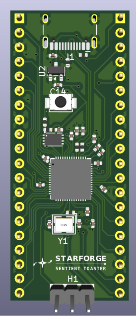
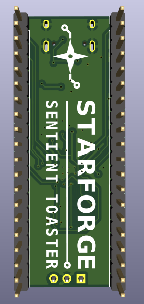
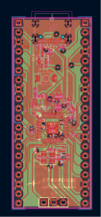
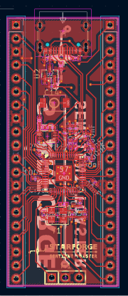
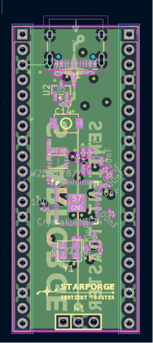
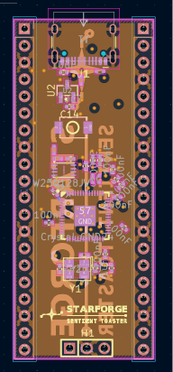
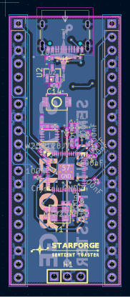

# Starforge-Dev-Board
A simple 4 layer RP2040 Dev Board powered by USB-C, with data and power delivery. Uses 24 GPIO and 4 ADC pins, alongside 1 3.3V and one 5V output. There is also 7 ground pins with 2 debug pins.
My goal with this project was to learn how to route properly and effectively on a PCB including decoupling caps and power because that is what I struggle with. I also wanted a simple board to use for my projects.
# PCB
Here is my PCB! This PCB was designed in KiCAD.

Schematic:

Top View (3d render):

Bottom View (3d render):

PCB Design:

First Layer: 

Second Layer:

Third Layer: 

Fourth Layer: 

## Layer Stackup
The board contains 4 layers. The purpose of all layers listed below.

| Layer | Description |
| 1 | Main routing layer |
| 2 | First ground layer for reference and signal separation |
| 3 | Second ground layer for reference and signal separation |
| 4 | Overflow routing layer |
## Flashing Instructions
Here are steps to flash a file to the MCU! 
1. Hold down the BOOTSEL button (the only button on the board) while plugging the board into your computer via USBC
2. The board will show up as a USB mass storage device
3. Compile your .uf2 binary file through external methods (C/C++ SDK, MicroPython, CircuitPython, etc)
4. Drag your compiled .uf2 file onto the drive. The board should automatically reboot and run the newly uploaded firmware!

# BOM

All SMD parts utilize 0402 passives to minimize board surface area. JLCPCB / LCSC part numbers are included below for reference.

| Item | Component / Description | Qty | Designators | Footprint | JLCPCB Part # |
| :--- | :--- | :---: | :--- | :--- | :--- |
| 1 | RP2040 Microcontroller | 1 | `U1` | `QFN-56_L7.0-W7.0-P0.4` | `C2040` |
| 2 | P25Q16SH-UXH-IR (16Mbit Flash) | 1 | `U3` | `USON8_L3.0-W2.0-P0.5` | `C7466821` |
| 3 | MCP1700T-3302E/TT (3.3V LDO) | 1 | `U2` | `SOT-23` | `C39051` |
| 4 | HC-TYPE-C-16P-01A (USB-C) | 1 | `J1` | `USB_C_Receptacle_16P` | `C2894897` |
| 5 | Crystal_GND24 (12MHz Crystal) | 1 | `Y1` | `SMD_4P-L3.2-W2.5` | `C9002` |
| 6 | TS-1088 Tactile Switch | 1 | `SW1` | `SW-SMD_L3.9-W3.0-P4.45` | `C720477` |
| 7 | Header Male 2.54mm 1x20 | 2 | `J2, J3` | `PinHeader_1x20_P2.54mm` | `C50981` |
| 8 | Header Male 2.54mm 1x3 | 1 | `H1` | `HDR-TH_3P-P2.54mm` | `C2937625` |
| 9 | 100nF Capacitor | 11 | `C2-C9, C11, C12, C17` | `C_0402` | `C1525` |
| 10 | 1uF Capacitor | 2 | `C1, C10` | `C_0402` | `C29266` |
| 11 | 10uF Capacitor | 2 | `C13, C14` | `C_0402` | `C15525` |
| 12 | 33pF Load Capacitor | 2 | `C15, C16` | `C_0402` | `C107005` |
| 13 | 5.1k Resistor | 2 | `R1, R2` | `R_0402` | `C25905` |
| 14 | 27Ω Resistor | 2 | `R5, R6` | `R_0402` | `C2909343` |
| 15 | 1k Resistor | 2 | `R4, R7` | `R_0402` | `C11702` |
| 16 | 10k Resistor | 1 | `R3` | `R_0402` | `C25744` |
