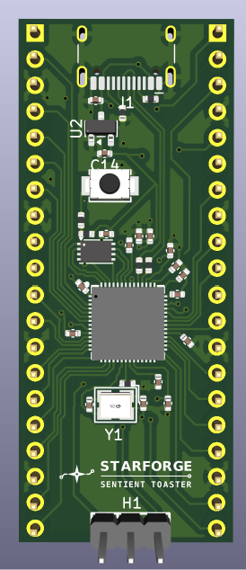
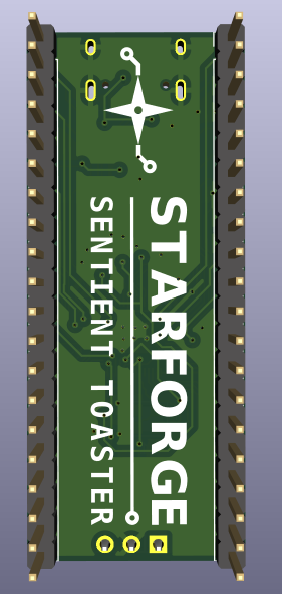
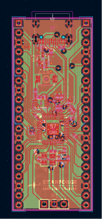
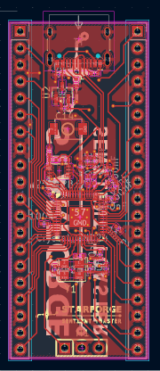
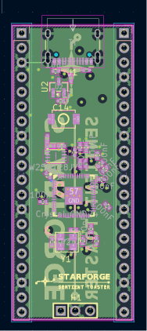
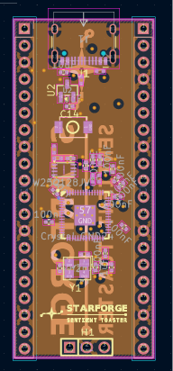
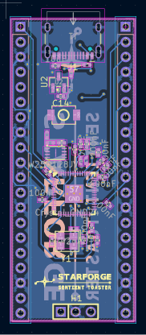

# Starforge-Dev-Board
A simple 4 layer RP2040 Dev Board powered by USB-C, with data and power delivery. Uses 24 GPIO and 4 ADC pins, alongside 1 3.3V and one 5V output. There is also 7 ground pins with 2 debug pins.
# PCB
Here is my PCB! This PCB was designed in KiCAD.

Top View:

Bottom View:

PCB Design:

First Layer: 

Second Layer:

Third Layer: 

Fourth Layer: 

# BOM
BOM.csv is now in the repo!
